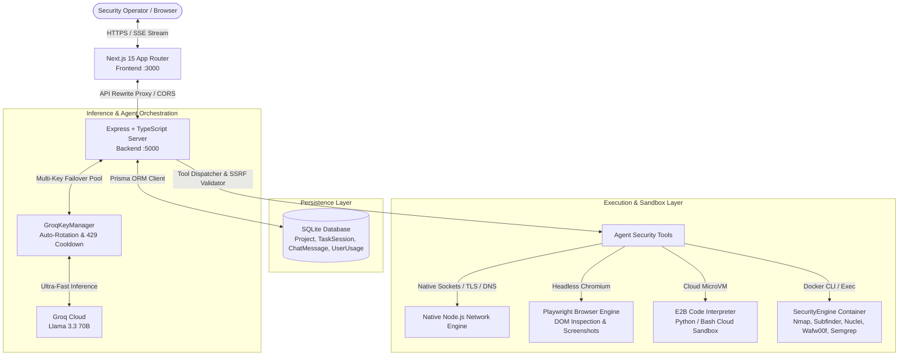

# 🛡️ Kairo | Autonomous Cybersecurity AI Copilot

[](https://nextjs.org/)
[](https://www.typescriptlang.org/)
[](https://groq.com/)
[](https://deepseek.com/)
[](https://tailwindcss.com/)
[](https://playwright.dev/)
[](https://e2b.dev/)
[](https://www.prisma.io/)
[](https://www.docker.com/)
[](https://kairo.bond)

> **Kairo** is an autonomous cybersecurity AI copilot and offensive-defensive intelligence workspace. Powered by Groq's high-speed inference (Llama 3.3 70B) and DeepSeek (V3 / Reasoner) with server-side rolling IP quotas, an autonomous **ReAct (Reasoning + Action)** agent loop, headless Playwright browser automation, E2B cloud microVM sandboxing, and a hardened containerized security engine, Kairo empowers penetration testers, security engineers, and bug bounty researchers to discover, analyze, and remediate vulnerabilities in real time.

---

## 📑 Table of Contents

- [Overview & Mission](#-overview--mission)
- [Key Features](#-key-features)
- [System Architecture](#-system-architecture)
- [Autonomous Security Agent & Integrated Tools](#-autonomous-security-agent--integrated-tools)
- [Repository & Directory Structure](#-repository--directory-structure)
- [Quick Start Guide](#-quick-start-guide)
  - [Prerequisites](#prerequisites)
  - [1. Clone Repository](#1-clone-repository)
  - [2. Environment Configuration](#2-environment-configuration)
  - [3. Database Migration](#3-database-migration)
  - [4. Security Engine Setup (Docker Sandbox)](#4-security-engine-setup-docker-sandbox-optional)
  - [5. Run the Application](#5-run-the-application)
- [Cloud Deployment (Railway + Vercel + `kairo.bond`)](#-cloud-deployment-railway--vercel--kairo-bond)
- [API Reference](#-api-reference)
- [Design System & UI Tokens](#-design-system--ui-tokens)
- [Legal & Responsible Disclosure](#-legal--responsible-disclosure)

---

## 🎯 Overview & Mission

Modern cybersecurity operations require orchestrating multiple command-line utilities (Nmap, Subfinder, Nuclei, Wafw00f), auditing live single-page web applications with headless browsers, parsing dense configurations, and verifying codebases. **Kairo** bridges the gap between raw command-line tools and autonomous AI reasoning:

1. **Autonomous ReAct Agent Loop**: Feed Kairo a domain, an IP, an API endpoint, or uploaded code. The AI formulates hypotheses, plans multi-stage tests, dispatches underlying network and browser tools, evaluates output observations, and executes follow-up actions.
2. **Zero-Context-Loss Multi-Key Failover**: Powered by `GroqKeyManager`, Kairo pools multiple Groq API keys with automatic 429 / rate-limit detection, key health cooldowns, and seamless rotation without losing ongoing multi-turn reasoning context.
3. **Headless Browser & Visual Reconnaissance**: Employs Playwright-driven Chromium to inspect live DOM trees, extract interactive form inputs, audit anti-CSRF protections, capture viewport screenshots, and test web application behaviors in real time.
4. **Isolated Sandboxed Execution**: Executes custom Python and Bash auditing scripts inside secure E2B Cloud MicroVMs or local Docker containers, keeping host environments fully isolated.
5. **SSRF & Scope Boundary Defense**: Built-in target scope validator blocks self-targeting, internal network addresses (`127.0.0.1`, `0.0.0.0`, `::1`), and cloud metadata APIs (`169.254.169.254`, `metadata.google.internal`).
6. **1:1 High-Precision Monochrome Dark UX**: Clean, distraction-free aesthetic (`#090909`, `#121212`, `#181818`, `#282828`) with Geist typography, collapsible reasoning drawers, interactive tool badges, and direct artifact viewers.

---

## ✨ Key Features

- **⚡ ReAct Autonomous Security Agent**:
  - Iterative reasoning cycles: `Thought` $\rightarrow$ `Action` $\rightarrow$ `Observation` $\rightarrow$ `Final Answer`.
  - Native socket/DNS fallback engines operate seamlessly even when Docker or external sandboxes are offline.
  - Context truncation protection caps verbose tool payloads to ensure high token efficiency.
- **🌐 Playwright Browser Exploration & Visual Verification**:
  - Headless Chromium navigates target web apps, extracts forms, checks cookie attributes (`HttpOnly`, `Secure`, `SameSite`), and evaluates client-side DOM security.
  - Interactive DOM testing (`browser_form_dom_test`) and viewport screenshot captures (`browser_capture_screenshot`) rendered directly in the user UI.
- **📎 Direct Artifact & Code File Attachments**:
  - Attach up to 3 files (up to 5MB each) per prompt—including Python scripts, JavaScript/TypeScript, Dockerfiles, Nginx configs, SQL dumps, and target lists.
  - Integrated `FileViewerModal` enables syntax-highlighted code inspection, line counts, and one-click clipboard copying.
- **🔑 Groq Key Manager & Zero-Loss Failover**:
  - Automatically discovers keys configured across `.env` (`GROQ_API_KEY`, `GROQ_API_KEYS`, `GROQ_API_KEY_1`, `GROQ_API_KEY_2`, etc.).
  - Auto-rotates active keys upon hitting Groq RPM/TPM limits (HTTP 429) with a 60-second cooldown per key, preventing interrupted scans.
- **💬 Real-Time SSE Streaming**:
  - Server-Sent Events stream live reasoning tokens, tool invocation badges with elapsed execution times, and incremental markdown responses.
  - Modal inspects raw CLI outputs, HTTP status codes, matched templates, and captured screenshots.
- **🗂️ Project & Multi-Session Management**:
  - SQLite persistence via Prisma ORM for project workspaces, categorized task threads, and chat history.
  - Single-session deletion, thread switching, and bulk clear history controls.
- **🧠 DeepSeek Paid AI Provider & IP-Based Quotas**:
  - Secure server-side DeepSeek integration (`DEEPSEEK_API_KEY` never exposed to client).
  - Strict 2-request limit within a 3-day rolling window per unique client IP.
  - Privacy-safe SHA-256 IP hashing with server-side salt (`IP_HASH_SALT`).
  - Concurrency-safe atomic reservations preventing race conditions via database transactions and mutex locks.
  - Automatic reservation release if the upstream API fails before generating usable output.
  - Clean HTTP 429 quota exhaustion messages with local timezone-formatted unlock timestamps.
- **🔐 User Authentication & Database Quotas**:
  - Supports Google OAuth and Credentials-based operator sign-in.
  - Enforces a persistent 2-chat free tier quota per account or IP via the `UserUsage` Prisma model.
- **🔧 Site-Wide Maintenance Mode**:
  - Instant toggle in `Frontend/middleware.ts` redirects visitors to a dedicated `/maintenance` screen while maintaining API and asset availability.

---

## 🏗️ System Architecture



---

## 🧰 Autonomous Security Agent & Integrated Tools

Kairo equips its autonomous agent with **12 specialized security tools**, bridging network scanning, web auditing, code analysis, and sandboxed execution:

| # | Tool Identifier | Category | Underlying Utility | Capability & Description |
| :-: | :--- | :--- | :--- | :--- |
| **1** | `waf_detection_wafw00f` | Reconnaissance | **Wafw00f** | Detects and fingerprints Web Application Firewalls (Cloudflare, AWS WAF, Akamai, Imperva, ModSecurity). |
| **2** | `subdomain_recon_subfinder` | Reconnaissance | **Subfinder / DNS** | Discovers passive subdomains across root domains to reveal forgotten staging and development infrastructure. |
| **3** | `port_service_scan_nmap` | Network Scanning | **Nmap / Sockets** | Scans common ports (HTTP, SSH, MySQL, Redis, etc.) and fingerprints active service banners and versions. |
| **4** | `vuln_template_scan_nuclei` | Vulnerability Scan | **Nuclei** | Scans target URLs against community vulnerability templates for known CVEs, exposures, and misconfigurations. |
| **5** | `analyze_security_headers` | Web Hardening | **HTTP Header Engine** | Audits CSP, HSTS, X-Frame-Options, CORS configurations, and flags server banner information leaks. |
| **6** | `passive_dns_recon` | DNS Intelligence | **Node DNS Sockets** | Resolves A, AAAA, MX, TXT, NS, and CNAME records; audits SPF and DMARC policies for email spoofing vulnerability. |
| **7** | `ssl_tls_certificate_audit` | Cryptography | **TLS Socket Engine** | Verifies SSL/TLS certificate validity, cipher suites, expiration dates, and extracts Subject Alternative Names (SANs). |
| **8** | `sast_code_security_audit` | Static Analysis | **Semgrep / SAST** | Analyzes code snippets for OWASP Top 10 flaws (SQLi, SSRF, RCE, IDOR, path traversal, hardcoded credentials). |
| **9** | `browser_web_exploration` | Web Recon | **Playwright Chromium** | Boots headless Chromium to inspect dynamic DOMs, extract inputs/forms, inspect cookies, and check anti-CSRF tokens. |
| **10** | `browser_form_dom_test` | Dynamic Testing | **Playwright Chromium** | Interacts with DOM inputs, submits test payloads, clicks buttons, and monitors JavaScript dialogs and console errors. |
| **11** | `browser_capture_screenshot` | Visual Proof | **Playwright Chromium** | Captures rendered viewport screenshots (base64 PNG) of target pages for visual evidence in security audit logs. |
| **12** | `sandbox_code_execution` | Sandboxing | **E2B MicroVM / Docker** | Executes Python and Bash security automation scripts safely inside isolated cloud microVMs or Docker containers. |

---

## 📁 Repository & Directory Structure

```
Kairoo/
├── .env.example                          # Central environment variable template
├── .gitignore                            # Multi-tier gitignore (node_modules, SQLite DBs, logs)
├── .node-version                         # Node.js version pinning (v20)
├── .nvmrc                                # NVM version specification (v20)
├── README.md                             # Comprehensive project documentation
├── design.md                             # UI/UX design specifications & color tokens
├── image.png                             # Architecture / landing page preview asset
├── nixpacks.toml                         # Nixpacks deployment configuration
│
├── Backend/                              # Express + TypeScript Server & AI Agent Core
│   ├── .env.example                      # Backend-specific environment template
│   ├── Dockerfile                        # Multi-stage production container with Playwright & Chromium
│   ├── nixpacks.toml                     # Nixpacks build rules for Railway
│   ├── package.json                      # Express, Groq SDK, Prisma, Playwright, Helmet, E2B
│   ├── railway.json                      # Railway deployment manifest
│   ├── tsconfig.json                     # TypeScript compiler configuration
│   ├── prisma/
│   │   └── schema.prisma                 # Backend Prisma Schema (TaskSession, Message, Project, UserUsage)
│   └── src/
│       ├── server.ts                     # Express app, Helmet, CORS, rate limiters, route mounts
│       ├── db.ts                         # Singleton Prisma Client instance
│       ├── agent/
│       │   ├── engine.ts                 # ReAct orchestrator loop, model resolver, token streaming
│       │   ├── groqKeyManager.ts         # Multi-key Groq pool with auto-failover & 429 cooldowns
│       │   ├── deepseekService.ts        # DeepSeek API integration (streaming, tool calling, think filter)
│       │   ├── tools.ts                  # 12 Security Agent tool definitions, SSRF scope defense
│       │   ├── browserEngine.ts          # Playwright headless browser engine & fallback HTTP inspector
│       │   ├── e2bSandbox.ts             # E2B cloud microVM execution with local Docker fallbacks
│       │   ├── dockerRunner.ts           # Docker CLI execution bridge for security tools
│       │   └── systemPrompt.ts           # Cyber security auditor system persona & instructions
│       ├── services/
│       │   └── deepseekQuotaService.ts   # 2-request/3-day rolling window IP quota & mutex lock
│       ├── middleware/
│       │   └── auth.ts                   # JWT token generation, verification & optional auth middleware
│       ├── routes/
│       │   ├── auth.ts                   # Google OAuth verification & credentials authentication
│       │   ├── chat.ts                   # POST /api/chat SSE stream & GET /api/chat/quota
│       │   ├── projects.ts               # GET/POST/DELETE /api/projects workspace management
│       │   └── tasks.ts                  # GET/DELETE /api/tasks chat thread history management
│       └── utils/
│           ├── ip.ts                     # Client IP extractor for proxy headers (Vercel, Railway, CF)
│           └── ipHash.ts                 # Privacy-safe SHA-256 IP normalizer & salting hasher
│   └── tests/
│       └── deepseekQuota.test.ts         # 15-scenario comprehensive test suite
│
├── Frontend/                             # Next.js 15 App Router Frontend
│   ├── next.config.mjs                   # Cache headers, optimizations, API proxy rewrites
│   ├── middleware.ts                     # Maintenance mode toggle & authentication route protector
│   ├── package.json                      # Next.js 15, React 19, Tailwind, Framer Motion, Lucide
│   ├── postcss.config.mjs                # PostCSS configuration
│   ├── tailwind.config.ts                # Monochrome palette, custom fonts, dark mode rules
│   ├── tsconfig.json                     # Frontend TypeScript configuration
│   ├── app/                              # Next.js 15 App Router
│   │   ├── layout.tsx                    # Root layout with Geist Sans & Mono fonts
│   │   ├── globals.css                   # Global dark styles, brutalist grid, custom scrollbars
│   │   ├── page.tsx                      # High-converting 1:1 minimalist landing page
│   │   ├── manifest.ts                   # Web App Manifest
│   │   ├── robots.ts                     # Search engine crawler policies
│   │   ├── sitemap.ts                    # Dynamic sitemap generator
│   │   ├── chat/
│   │   │   └── page.tsx                  # Main security copilot interactive workspace
│   │   ├── auth/
│   │   │   └── page.tsx                  # Unified authentication router
│   │   ├── login/
│   │   │   └── page.tsx                  # Operator sign-in page
│   │   ├── register/
│   │   │   └── page.tsx                  # Operator registration page
│   │   ├── signin/
│   │   │   └── page.tsx                  # Sign-in alias
│   │   ├── signup/
│   │   │   └── page.tsx                  # Sign-up alias
│   │   ├── product/
│   │   │   └── page.tsx                  # Product features & capabilities overview
│   │   ├── features/
│   │   │   └── page.tsx                  # Deep-dive feature breakdown
│   │   ├── security/
│   │   │   └── page.tsx                  # Security architecture & defensive practices
│   │   ├── docs/
│   │   │   └── page.tsx                  # Interactive platform documentation
│   │   ├── settings/
│   │   │   └── page.tsx                  # User profile, AI model, & security settings
│   │   ├── maintenance/
│   │   │   └── page.tsx                  # Dedicated maintenance mode landing screen
│   │   ├── blog/
│   │   │   ├── page.tsx                  # Engineering & security research blog hub
│   │   │   ├── browser-automation-visual-recon/page.tsx # Headless browser recon release post
│   │   │   └── file-attachments/page.tsx # Code & artifact attachment release post
│   │   ├── privacy/
│   │   │   └── page.tsx                  # Privacy policy statement
│   │   ├── privacy-policy/
│   │   │   └── page.tsx                  # Extended privacy policy
│   │   ├── terms/
│   │   │   └── page.tsx                  # Terms of service & usage conditions
│   │   ├── trust/
│   │   │   └── page.tsx                  # Compliance, encryption, & trust disclosures
│   │   ├── disclosure/
│   │   │   └── page.tsx                  # Vulnerability reporting program
│   │   └── responsible-disclosure/
│   │       └── page.tsx                  # Ethical hacking & bug reporting guidelines
│   ├── components/                       # Modular UI Components
│   │   ├── HackerAILogo.tsx              # Origami vector logo component
│   │   ├── Navbar.tsx                    # Top navigation with live auth status
│   │   ├── Footer.tsx                    # Universal site footer with quick links
│   │   ├── Sidebar.tsx                   # Project switcher, task sessions, trash controls
│   │   ├── ChatHeader.tsx                # Session title bar, model indicators, share triggers
│   │   ├── PromptInput.tsx               # Auto-growing prompt bar, model picker, file drop zone
│   │   ├── MessageList.tsx               # Virtualized chat stream container
│   │   ├── UserMessage.tsx               # Operator message renderer with attached artifacts
│   │   ├── AssistantMessage.tsx          # Markdown response renderer, code highlighting
│   │   ├── ReasoningBlock.tsx            # Collapsible chain-of-thought drawer with timer
│   │   ├── ToolPill.tsx                  # Interactive tool status badge with live spinners
│   │   └── modals/
│   │       ├── FileViewerModal.tsx       # Syntax-highlighted code/config viewer modal
│   │       ├── ToolDetailModal.tsx       # Raw tool output, screenshot, & telemetry modal
│   │       ├── SettingsModal.tsx         # Multi-tab settings (General, AI, Security, Data)
│   │       ├── NewProjectModal.tsx       # Workspace creation modal
│   │       ├── SearchModal.tsx           # Global search for sessions and findings
│   │       └── ShareModal.tsx            # Session sharing modal
│   ├── lib/
│   │   ├── session.ts                    # LocalStorage / SessionStorage / Cookie session helpers
│   │   ├── db.ts                         # Edge/Next.js Prisma client instance
│   │   ├── groq.ts                       # Groq client factory
│   │   └── agent/
│   │       ├── engine.ts                 # Standalone/edge fallback agent engine
│   │       ├── tools.ts                  # Client/edge security tool handlers
│   │       └── systemPrompt.ts           # Prompt constants
│   ├── types/
│   │   └── chat.ts                       # TypeScript definitions for messages, tools, steps
│   ├── data/
│   │   └── initialData.ts                # Default seed projects & sample task threads
│   └── public/                           # Static assets, branding logos, icons, favicon
│
├── Database/                             # Central Database Package
│   ├── package.json                      # Prisma client script bindings
│   ├── tsconfig.json                     # TypeScript configuration
│   ├── prisma/
│   │   └── schema.prisma                 # Canonical schema for standalone db commands
│   └── src/
│       └── client.ts                     # Exported Prisma Client singleton
│
└── SecurityEngine/                       # Containerized Sandbox Environment
    ├── Dockerfile                        # Alpine container with Nmap, Nuclei, Subfinder, Wafw00f
    ├── docker-compose.yml                # Standalone compose configuration
    └── setup.sh                          # Automated build and run script
```

---

## 🚀 Quick Start Guide

### Prerequisites
- **Node.js**: `v20.0.0` or higher
- **npm** or **pnpm**
- **Docker** *(Optional, required for containerized CLI tools)*
- **Groq API Key**: Obtain a free, high-speed API key from [console.groq.com](https://console.groq.com)
- **E2B API Key** *(Optional, for cloud microVM script execution)*: [e2b.dev](https://e2b.dev)

---

### 1. Clone Repository

```bash
git clone https://github.com/Aokiro112/Kairoo.git
cd Kairoo
```

---

### 2. Environment Configuration

Create a `.env` file in the root directory (or inside `Backend/`):

```bash
cp .env.example Backend/.env
```

Edit `Backend/.env` with your preferred configurations:

```env
# Server & Database Configuration
PORT=5000
DATABASE_URL="file:./prisma/dev.db"

# Groq API Multi-Key Failover Pool (Add one or more keys)
# The key manager will auto-rotate and place rate-limited keys into cooldown
GROQ_API_KEY_1="gsk_primary_key_here"
GROQ_API_KEY_2="gsk_backup_key_here"

# DeepSeek Paid AI Provider (Server-Side Only)
DEEPSEEK_API_KEY="sk-your-deepseek-key-here"
DEEPSEEK_MODEL="deepseek-chat"
IP_HASH_SALT="kairo_deepseek_ip_salt_v1"

# Optional: E2B Cloud MicroVM Sandbox for Python/Bash Execution
E2B_API_KEY=""

# Optional: Google OAuth Client ID & Secret
GOOGLE_CLIENT_ID=""
GOOGLE_CLIENT_SECRET=""
```

---

### 3. Database Migration

Initialize the SQLite database schema using Prisma:

```bash
cd Backend
npm install
npx prisma generate
npx prisma db push
cd ..
```

---

### 4. Security Engine Setup (Docker Sandbox) *(Optional)*

To enable containerized execution for `nmap`, `subfinder`, `nuclei`, and `wafw00f`:

```bash
cd SecurityEngine
chmod +x setup.sh
./setup.sh
cd ..
```

> **Note**: If Docker is not running, Kairo automatically falls back to its built-in native socket, DNS, and HTTP inspection engines without crashing.

---

### 5. Run the Application

#### Start the Backend Server:
```bash
cd Backend
npm run dev
# Running on http://localhost:5000
```

#### In a separate terminal, start the Frontend:
```bash
cd Frontend
npm install
npm run dev
# Running on http://localhost:3000
```

Open **`http://localhost:3000`** in your browser to access Kairo.

---

## ☁️ Cloud Deployment (Railway + Vercel + `kairo.bond`)

### 1. Deploy Backend on [Railway](https://railway.app)
1. In Railway, click **New Project** $\rightarrow$ **Deploy from GitHub repo** $\rightarrow$ select `Aokiro112/Kairoo`.
2. Set the **Root Directory** to `/Backend`.
3. In **Variables**, configure:
   ```env
   PORT=5000
   DATABASE_URL="file:/app/prisma/dev.db"
   GROQ_API_KEY_1="gsk_your_key_1"
   GROQ_API_KEY_2="gsk_your_key_2"
   ```
4. In **Networking**, click **Generate Domain** (e.g. `https://kairo-backend-production.up.railway.app`) or attach a custom domain such as `api.kairo.bond`.

---

### 2. Deploy Frontend on [Vercel](https://vercel.com)
1. In Vercel, click **Add New...** $\rightarrow$ **Project** $\rightarrow$ import `Aokiro112/Kairoo`.
2. Set the **Root Directory** to `Frontend`.
3. In **Environment Variables**, add:
   ```env
   BACKEND_URL=https://kairo-backend-production.up.railway.app
   ```
   *(Next.js will automatically proxy all `/api/*` traffic to your Railway backend without CORS or mixed-content issues).*
4. Click **Deploy**.

---

### 3. Attach Custom Domain (`kairo.bond`)
1. In your **Vercel Project Dashboard** $\rightarrow$ **Settings** $\rightarrow$ **Domains**, add:
   - `kairo.bond`
   - `www.kairo.bond`
2. At your DNS provider (Cloudflare, Porkbun, Namecheap, GoDaddy):
   - **Type**: `A` | **Name**: `@` | **Value**: `76.76.21.21`
   - **Type**: `CNAME` | **Name**: `www` | **Value**: `cname.vercel-dns.com`
3. *(Optional for API)*: In Railway **Settings** $\rightarrow$ **Custom Domain**, add `api.kairo.bond` and point the `CNAME` in your DNS provider.

---

## 🔌 API Reference

### Health & Diagnostics
- **`GET /api/health`**
  - Returns backend operational status, active domain (`kairo.bond`), and loaded Groq key count.
- **`GET /api/groq/keys`**
  - Diagnostic endpoint returning the total number of keys in the pool and individual cooldown statuses.

### Authentication
- **`POST /api/auth/google`**
  - Verifies Google OAuth token or code server-side and issues a session JWT.
- **`POST /api/auth/login`**
  - Authenticates credentials-based operators and generates an authentication token.
- **`POST /api/auth/register`**
  - Registers a new security operator account.

### Chat, Quotas & Real-Time Agent Stream
- **`GET /api/chat/quota`**
  - Returns current DeepSeek quota status for the caller's IP hash without consuming a request.
  - **Response**:
    ```json
    {
      "provider": "deepseek",
      "limit": 2,
      "used": 1,
      "remaining": 1,
      "resetAt": "2026-09-16T10:00:00.000Z",
      "windowStart": "2026-09-13T10:00:00.000Z"
    }
    ```
- **`POST /api/chat`**
  - Initiates an SSE (Server-Sent Events) stream with the ReAct security agent (Groq or DeepSeek).
  - **Request Body**:
    ```json
    {
      "taskId": "task-1710345678",
      "projectId": "default",
      "model": "deepseek-chat",
      "userMessageText": "Audit example.com for missing security headers and WAF",
      "attachments": [
        {
          "name": "nginx.conf",
          "size": 1024,
          "content": "server { listen 80; server_name example.com; }",
          "language": "nginx"
        }
      ]
    }
    ```
  - **Quota Exceeded Error (HTTP 429)**:
    ```json
    {
      "error": "DEEPSEEK_LIMIT_REACHED",
      "message": "You have used your 2 DeepSeek messages.",
      "limit": 2,
      "used": 2,
      "resetAt": "2026-09-16T10:00:00.000Z"
    }
    ```
  - **Streamed Event Types**:
    - `meta`: Session metadata, provider (`deepseek` or `groq`), and assigned task ID.
    - `reasoning`: Real-time chain-of-thought analysis tokens.
    - `tool_group`: Tool invocation notifications, status updates, and raw results.
    - `content_chunk`: Incremental Markdown response text.
    - `done`: Stream completion and assistant message ID.

### Workspace & Session Management
- **`GET /api/projects`**: Lists all active projects and associated session counts.
- **`POST /api/projects`**: Creates a new project workspace.
- **`DELETE /api/projects/:id`**: Deletes a project workspace.
- **`GET /api/tasks`**: Fetches all saved chat sessions with full message and step histories.
- **`DELETE /api/tasks/:id`**: Deletes a specific session.
- **`DELETE /api/tasks`**: Deletes all session histories.

---

## 🎨 Design System & UI Tokens

Kairo implements a minimalist, high-contrast monochrome design system built for maximum visual clarity:

| Design Token | Value / Tailwind Class | Description |
| :--- | :--- | :--- |
| **Canvas Background** | `#090909` / `bg-[#090909]` | Deep neutral background |
| **Card & Panel Surface** | `#121212` / `bg-[#121212]` | Elevated panels, prompt box, modals |
| **Sidebar & Nav Surface** | `#161616` / `bg-[#161616]` | Sidebar surfaces and headers |
| **Dividers & Borders** | `#282828` / `border-[#282828]` | Subtle, non-intrusive container borders |
| **Active Highlights** | `#222222` / `bg-[#222222]` | Hover states and interactive pills |
| **Primary Typography** | `#F4F4F0` / `text-[#F4F4F0]` | High-legibility off-white text |
| **Muted Metadata** | `#757575` / `text-[#757575]` | Timestamps, file sizes, and secondary labels |
| **Accent Badges** | `Emerald`, `Cyan`, `Amber` | Strictly reserved for tool states (Running, Done, Failed) |
| **Font Family** | `Geist Sans` & `Geist Mono` | Optimized developer and terminal typography |

---

## ⚖️ Legal & Responsible Disclosure

> **IMPORTANT DISCLAIMER**:
> Kairo is designed exclusively for authorized penetration testing, security research, infrastructure hardening, and educational auditing.
> 
> Scanning, probing, or attacking networks, servers, or web applications without explicit, prior written authorization is illegal. Operators must strictly follow responsible disclosure principles and comply with all applicable local, national, and international laws. The authors and maintainers assume no liability for misuse or damage caused by this software.
