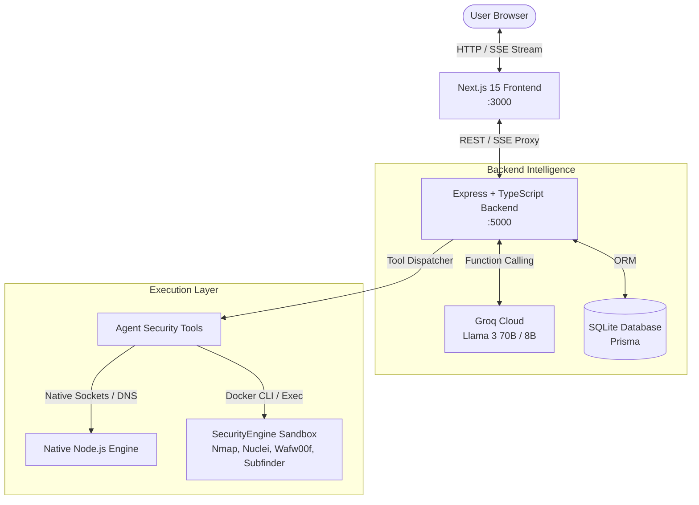

# 🛡️ Kairo | Autonomous Cybersecurity AI Copilot

[](https://nextjs.org/)
[](https://www.typescriptlang.org/)
[](https://groq.com/)
[](https://tailwindcss.com/)
[](https://www.prisma.io/)
[](https://www.docker.com/)

> **Kairo** is an autonomous cybersecurity AI copilot and vulnerability scanning workspace. Powered by Groq's high-speed inference (Llama 3 70B/8B), an autonomous **ReAct (Reasoning + Action)** agent engine, and a sandboxed security toolkit, it assists penetration testers, bug bounty hunters, and security engineers in discovering, analyzing, and remediating vulnerabilities in real time.

---

## 📑 Table of Contents

- [Overview & Purpose](#-overview--purpose)
- [Key Features](#-key-features)
- [System Architecture](#-system-architecture)
- [Security Agent & Integrated Tools](#-security-agent--integrated-tools)
- [Project Structure](#-project-structure)
- [Quick Start Guide](#-quick-start-guide)
  - [Prerequisites](#prerequisites)
  - [1. Clone Repository](#1-clone-repository)
  - [2. Environment Configuration](#2-environment-configuration)
  - [3. Database Setup](#3-database-setup)
  - [4. Security Engine Setup (Docker)](#4-security-engine-setup-docker)
  - [5. Run the Application](#5-run-the-application)
- [API Reference](#-api-reference)
- [Design System](#-design-system)
- [Legal & Responsible Disclosure](#-legal--responsible-disclosure)

---

## 🎯 Overview & Purpose

Modern security assessments require coordinating multiple command-line utilities (reconnaissance, port scanning, header inspection, CVE matching) and synthesizing dense outputs. **Kairo** bridges this gap:

1. **Autonomous Intelligence**: You provide a target domain or security query; the AI reasons step-by-step, autonomously executes appropriate security tools, inspects the results, and performs follow-up scans.
2. **Real-Time Transparency**: Live Server-Sent Events (SSE) stream the AI's internal chain of thought (`Thinking...`), tool execution pills (`Scanning ports`, `WAF detection`), and structured vulnerability findings.
3. **1:1 Monochrome Dark UX**: Implements the clean, high-precision dark design of [hackerai.co](https://hackerai.co) (`#131313`, `#181818`, `#282828`) with zero purple or distracting neon accents.

---

## ✨ Key Features

- **🌐 Authentic 1:1 Landing Page (`/`)**:
  - Exact geometric origami vector logo and minimalist navigation.
  - Interactive typewriter placeholder reveal with live prompt submission.
  - Seamless handoff to the `/chat` workspace upon submission.
- **⚡ ReAct Autonomous Security Agent**:
  - Multi-step iterative reasoning loop (`Thought` $\rightarrow$ `Action` $\rightarrow$ `Observation` $\rightarrow$ `Final Answer`).
  - Native fallback mode: Runs instant network & DNS sockets even without Docker; executes full containerized binaries when Docker is active.
- **💬 Real-Time SSE Streaming**:
  - Live token streaming via Server-Sent Events.
  - Interactive, collapsible `<details>` reasoning blocks with elapsed timers.
  - Clickable tool execution badges with micro-spinners and detailed modal inspection (status codes, response times, raw command output).
- **🗂️ Project & History Management**:
  - Full SQLite persistence via Prisma ORM.
  - Multi-session chat history, project switching, single-item trash deletion, and global clear controls.
- **🛡️ Sandboxed Execution (Docker SecurityEngine)**:
  - Isolated Alpine container preloaded with `nmap`, `subfinder`, `httpx`, `nuclei`, `wafw00f`, and `semgrep`.

---

## 🏗️ System Architecture



---

## 🧰 Security Agent & Integrated Tools

The AI agent has autonomous access to the following security tools:

| Tool Identifier | Underlying Utility | Capability & Description |
| :--- | :--- | :--- |
| `waf_detection_wafw00f` | **Wafw00f** | Detects and fingerprints Web Application Firewalls (Cloudflare, AWS WAF, Akamai, Imperva, ModSecurity). |
| `subdomain_recon_subfinder` | **Subfinder / DNS** | Discovers subdomains across target root domains to map forgotten assets and staging servers. |
| `port_service_scan_nmap` | **Nmap / Socket Scanner** | Scans top ports (HTTP, SSH, MySQL, Redis, etc.) and fingerprints running services. |
| `vuln_template_scan_nuclei` | **Nuclei** | Scans targets using community vulnerability templates for known CVEs, exposures, and misconfigurations. |
| `analyze_security_headers` | **HTTP Header Engine** | Inspects CSP, HSTS, X-Frame-Options, CORS, and detects server banner information leaks. |
| `passive_dns_recon` | **DNS Enumeration** | Resolves A, AAAA, MX, TXT, NS, CNAME records; audits SPF and DMARC for email spoofing risks. |
| `ssl_tls_certificate_audit` | **TLS Socket Engine** | Audits SSL/TLS certificate validity, expiration, cipher suites, and extracts Subject Alternative Names (SANs). |
| `sast_code_security_audit` | **Semgrep / SAST Engine** | Analyzes code snippets for OWASP Top 10 vulnerabilities (SQLi, SSRF, RCE, IDOR, hardcoded secrets). |

---

## 📁 Project Structure

```
.
├── Backend/                       # Express + TypeScript Server & Agent Engine
│   ├── prisma/                    # Backend Prisma Schema & Migrations
│   ├── src/
│   │   ├── agent/                 # Autonomous ReAct Agent Loop
│   │   │   ├── dockerRunner.ts    # Docker Sandbox Bridge
│   │   │   ├── engine.ts          # Multi-turn Loop & LLM Orchestration
│   │   │   ├── systemPrompt.ts    # Security Persona & Tool Prompts
│   │   │   └── tools.ts           # 8+ Integrated Security Tools
│   │   ├── routes/                # API Routes (/chat, /projects, /tasks)
│   │   ├── db.ts                  # Database Client
│   │   └── server.ts              # Express App Entry Point
│   ├── .env.example               # Backend Env Template
│   ├── package.json
│   └── tsconfig.json
│
├── Frontend/                      # Next.js 15 App Router Frontend
│   ├── app/
│   │   ├── page.tsx               # Root Landing Page (1:1 hackerai.co)
│   │   ├── chat/page.tsx          # Main Security Copilot Workspace
│   │   ├── landing/page.tsx       # Auto-redirect to root /
│   │   ├── globals.css            # Dark Monochrome Design Tokens
│   │   └── layout.tsx             # Root Layout with Geist Font
│   ├── components/                # Reusable UI Components
│   │   ├── HackerAILogo.tsx       # Geometric Origami Vector Logo
│   │   ├── AssistantMessage.tsx   # Markdown & Thinking Renderer
│   │   ├── ReasoningBlock.tsx     # Collapsible Chain-of-Thought
│   │   ├── ToolPill.tsx           # Interactive Tool Badges
│   │   ├── PromptInput.tsx        # Auto-growing Prompt Box
│   │   ├── Sidebar.tsx            # Session History & Projects Sidebar
│   │   └── modals/                # Search, New Project, Share, Tool Modals
│   ├── package.json
│   └── tailwind.config.ts         # Monochrome Color Palette Configuration
│
├── Database/                      # Central Prisma & SQLite Store
│   ├── prisma/
│   │   ├── schema.prisma          # Database Models (Project, Task, Message)
│   │   └── dev.db                 # SQLite Database File (Git-ignored)
│   └── package.json
│
├── SecurityEngine/                # Sandboxed Docker Security Container
│   ├── Dockerfile                 # Alpine image with Nmap, Nuclei, Wafw00f, Subfinder
│   ├── docker-compose.yml         # Container orchestration
│   └── setup.sh                   # Sandbox build & launch helper
│
├── .gitignore                     # Multi-layer gitignore rules
└── README.md                      # Project Documentation
```

---

## 🚀 Quick Start Guide

### Prerequisites
- **Node.js**: `v18.0.0` or higher
- **npm** or **pnpm**
- **Docker** *(Optional, but recommended for full CLI tool execution)*
- **Groq API Key**: Obtain a free, ultra-fast API key from [console.groq.com](https://console.groq.com)

---

### 1. Clone Repository
```bash
git clone https://github.com/yourusername/hackerai-dark.git
cd hackerai-dark
```

---

### 2. Environment Configuration

Create a `.env` file inside `Backend/`:
```bash
cp Backend/.env.example Backend/.env
```

Edit `Backend/.env` and add your Groq API key(s):
```env
PORT=5000
DATABASE_URL="file:../Database/prisma/dev.db"

# Multi-Key Failover Pool (Add multiple comma-separated keys for auto-rotation on 429 rate limits):
GROQ_API_KEYS="gsk_key1_here,gsk_key2_here,gsk_key3_here"

# Or single key:
GROQ_API_KEY="gsk_key1_here"
```

> **⚡ Zero-Context-Loss Failover**: If any key in the pool hits a Groq rate limit (`429 Too Many Requests` / RPM / TPM limit), `GroqKeyManager` automatically places the exhausted key into a 60s cooldown, switches to the next available healthy key in the pool, and retries the multi-turn reasoning or tool-calling request immediately without losing chat context.

---

### 3. Database Setup

Install dependencies and generate Prisma client:
```bash
# Database setup
cd Database
npm install
npx prisma generate
npx prisma db push
cd ..
```

---

### 4. Security Engine Setup (Docker) *(Optional)*

To enable containerized execution for `nmap`, `subfinder`, `nuclei`, and `wafw00f`:
```bash
cd SecurityEngine
docker compose up -d --build
cd ..
```
> *Note: If Docker is not running, Kairo will automatically use its built-in native socket & DNS fallback engines without failing.*

---

### 5. Run the Application

#### Start the Backend Server:
```bash
cd Backend
npm install
npm run dev
# Running at http://localhost:5000
```

#### In a new terminal, start the Frontend:
```bash
cd Frontend
npm install
npm run dev
# Running at http://localhost:3000
```

Now open **`http://localhost:3000`** in your browser.

---

## 🔌 API Reference

### Health Check
- **`GET /api/health`**
  - Returns backend status and timestamp.

### Chat & AI Agent Stream
- **`POST /api/chat`**
  - Initiates an SSE stream with the ReAct security agent.
  - **Body**:
    ```json
    {
      "messages": [
        { "role": "user", "content": "Scan scanme.nmap.org for open ports" }
      ],
      "projectId": "default"
    }
    ```
  - **Event Types Streamed**:
    - `reasoning`: Chain-of-thought tokens
    - `tool_start`: Tool execution initiated with parameters
    - `tool_end`: Tool execution completed with results
    - `token`: Final markdown answer tokens
    - `done`: Stream termination signal

### Projects Management
- **`GET /api/projects`**: List all saved projects and chat threads.
- **`POST /api/projects`**: Create a new project workspace.
- **`DELETE /api/projects/:id`**: Delete a project and its chat history.

---

## ☁️ Cloud Deployment Guide (Vercel + Railway + `kairo.bond`)

### 1. Deploy Backend on [Railway](https://railway.app)
1. Go to [railway.app](https://railway.app) and create a **New Project** $\rightarrow$ **Deploy from GitHub repo**.
2. Set **Root Directory** to `/Backend`.
3. In **Settings** $\rightarrow$ **Variables**, add:
   ```env
   PORT=5000
   DATABASE_URL="file:./prisma/dev.db"
   GROQ_API_KEYS="gsk_key1,gsk_key2"
   ```
4. In **Settings** $\rightarrow$ **Networking**, click **Generate Domain** (e.g. `https://kairo-backend-production.up.railway.app`) or attach custom domain `api.kairo.bond`.

---

### 2. Deploy Frontend on [Vercel](https://vercel.com)
1. Go to [vercel.com](https://vercel.com) and click **Add New...** $\rightarrow$ **Project** $\rightarrow$ Import your GitHub repository.
2. Set **Root Directory** to `Frontend`.
3. In **Environment Variables**, add:
   ```env
   BACKEND_URL=https://kairo-backend-production.up.railway.app
   ```
   *(Replace with your actual Railway backend URL or `https://api.kairo.bond`)*.
4. Click **Deploy**. Next.js will automatically proxy all `/api/*` requests to your Railway backend without CORS or mixed-content issues.

---

### 3. Connect Custom Domain (`kairo.bond`)
1. In your **Vercel Dashboard** $\rightarrow$ **Settings** $\rightarrow$ **Domains**, enter **`kairo.bond`** (and `www.kairo.bond`).
2. Go to your DNS Registrar (e.g. Cloudflare, Namecheap, GoDaddy, Porkbun) and add the records provided by Vercel:
   - **Type**: `A` | **Name**: `@` | **Value**: `76.76.21.21`
   - **Type**: `CNAME` | **Name**: `www` | **Value**: `cname.vercel-dns.com`
3. *(Optional for API)*: In Railway **Settings** $\rightarrow$ **Custom Domain**, add `api.kairo.bond` and add the corresponding `CNAME` in your DNS provider.

---

## 🎨 Design System

Kairo uses a tailored monochrome design system inspired by top cybersecurity developer tools:

| Element | Color Token | Hex Code |
| :--- | :--- | :--- |
| **Page Background** | `bg-[#131313]` | `#131313` |
| **Card & Sidebar Surface** | `bg-[#181818]` | `#181818` |
| **Border & Dividers** | `border-[#282828]` | `#282828` |
| **Subtle Highlights** | `bg-[#222222]` | `#222222` |
| **Primary Text** | `text-white` | `#FFFFFF` |
| **Secondary Subtitle** | `text-[#9E9E9E]` | `#9E9E9E` |
| **Muted Labels** | `text-[#6B6B6B]` | `#6B6B6B` |
| **Typography** | `Geist Sans` & `Geist Mono` | Standard clean sans-serif |

---

## ⚖️ Legal & Responsible Disclosure

> **WARNING / DISCLAIMER**:
> Kairo is engineered strictly for authorized security auditing, educational research, defensive hardening, and authorized penetration testing. 
> 
> Scanning, probing, or attacking systems without prior explicit written permission is strictly prohibited by law. Always adhere to responsible disclosure guidelines and obtain proper authorization before targeting any third-party infrastructure.
